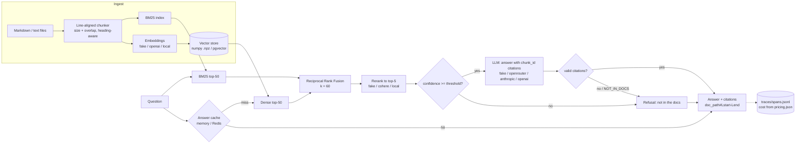

# docs-rag

Question answering over a documentation corpus that **cites its sources, refuses when the
answer is not in the docs, and measures itself**. Hybrid retrieval (BM25 + dense) fused with
Reciprocal Rank Fusion, a rerank stage, a cited-answer generator with a hard refusal path, a
golden-set evaluation harness with a calibrated judge, per-span tracing with cost accounting,
an exact-match answer cache, a daily cost cap and per-IP rate limiting.

Runs end to end with no API key (`LLM_PROVIDER=fake`): the fake backends are deterministic, so
tests, the eval report and the demo are reproducible in CI. Set `OPENROUTER_API_KEY` and the
same code runs against real models.

## Problem

Internal handbooks answer most of the questions engineers ask each other, but nobody reads
them. A chat interface over the docs only helps if (a) the answer comes with a link to the
exact lines it was taken from, so the reader can verify it in two seconds, and (b) it says
"not in the docs" instead of inventing a policy. A plain "retrieve top-5 chunks and ask the
model" baseline gets neither reliably; this repository builds the baseline first and then
measures every step that improves on it.

### Corpus

`data/corpus/` is a synthetic, 40-page *Larkspur Systems Engineering Handbook* (about 14k
words, MIT licensed, written for this repository so there are no licensing questions):
onboarding, code review, style guides, CI, release trains, feature flags, deployments,
on-call, incidents, postmortems, SLOs, observability, Kubernetes, Terraform, migrations, API
design, secrets, access control, vulnerability response, data retention, backups, caching,
messaging, RFCs, ADRs, hiring, career ladder, cost management and more. Every page has
concrete numbers and names so that questions have unambiguous answers. Point `CORPUS_PATH` at
any folder of Markdown or text files to use your own notes.

## Architecture



Every stage emits a span; every paid call is priced; every citation is checked against the
chunks the model actually saw before it is returned.

## Quickstart

```bash
make setup            # uv python install 3.12 + uv sync + copy .env.example to .env
make demo             # ask five questions from the CLI with the fake provider
make serve            # API + UI on http://localhost:8000
```

Real models: put `OPENROUTER_API_KEY=...` in `.env` (OpenRouter is the default real backend;
`anthropic` and `openai` direct backends are also implemented), optionally
`EMBEDDING_PROVIDER=openai` with an `OPENAI_API_KEY` and `RERANKER=cohere` with a
`COHERE_API_KEY`, then run `make eval` for real numbers.

```bash
curl -s localhost:8000/ask -H 'content-type: application/json' \
     -d '{"question": "How long does the canary receive traffic before it is promoted?"}'
```

### A cited answer

```json
{
  "answer": "Production deploys start with a canary that receives 5% of traffic for ten minutes. [ce160a0b63] The canary is promoted automatically when all of the following hold compared with the baseline. [ce160a0b63]",
  "citations": [
    {
      "chunk_id": "ce160a0b63",
      "doc_path": "13-deployments-and-rollbacks.md",
      "start_line": 17,
      "end_line": 31,
      "snippet": "## Canary analysis Production deploys start with a canary that receives 5% of traffic for ten minutes. The canary is promoted automatically when all of the following hold compared with the baseline: - HTTP 5xx rate is …"
    }
  ],
  "refused": false,
  "refusal_reason": null,
  "trace_id": "3f0d3b6e-…",
  "latency_ms": 6.1,
  "cost_usd": 0.0,
  "cache_hit": false,
  "confidence": 0.62
}
```

The UI renders `[ce160a0b63]` as a link to
`/docs/13-deployments-and-rollbacks.md?start=17&end=31#L17`, which serves the source file with
line anchors and the cited span highlighted.

### A correct refusal

```json
{
  "answer": "I could not find this in the documentation.",
  "citations": [],
  "refused": true,
  "refusal_reason": "low_retrieval_confidence",
  "trace_id": "9a71c0de-…",
  "latency_ms": 4.3,
  "cost_usd": 0.0,
  "cache_hit": false,
  "confidence": 0.0
}
```

Refusal has three independent triggers: the reranker's top score is below
`REFUSAL_THRESHOLD` (no model call is made), the model replies `NOT_IN_DOCS`, or the model's
answer contains no citation that maps to a chunk it was shown (invented ids are dropped and an
answer with no valid citation is treated as unsupported).

## Results

Produced by `make eval` (`scripts/eval.py --mode all`), written to `reports/results.md` and
`reports/eval-<variant>.json`. **Fake provider: these numbers describe the plumbing, not a
model.** Run `make eval` with `OPENROUTER_API_KEY` set for real numbers.

<!-- results:start -->
### All cases (222)

| variant | recall@5 | recall@20 | precision@5 | MRR | faithfulness | halluc. rate | refusal recall | false refusal | p95 ms | $/1k (projected) |
|---|---|---|---|---|---|---|---|---|---|---|
| naive | 0.991 | 1.000 | 0.346 | 0.964 | 1.000 | 0.009 | 0.750 | 0.014 | 2 | 3.565 |
| hybrid | 0.998 | 1.000 | 0.348 | 0.993 | 1.000 | 0.014 | 0.625 | 0.009 | 3 | 3.598 |
| reranked | 1.000 | 1.000 | 0.349 | 0.986 | 1.000 | 0.014 | 0.625 | 0.009 | 12 | 3.613 |
| final | 1.000 | 1.000 | 0.349 | 0.986 | 1.000 | 0.014 | 0.625 | 0.009 | 13 | 3.613 |

### Source: human (23 cases)

| variant | recall@5 | recall@20 | precision@5 | MRR | faithfulness | halluc. rate | refusal recall | false refusal | p95 ms | $/1k (projected) |
|---|---|---|---|---|---|---|---|---|---|---|
| naive | 0.900 | 1.000 | 0.200 | 0.840 | 1.000 | 0.125 | 0.750 | 0.067 | 3 | 3.367 |
| hybrid | 0.967 | 1.000 | 0.213 | 0.967 | 1.000 | 0.167 | 0.625 | 0.000 | 3 | 3.502 |
| reranked | 1.000 | 1.000 | 0.227 | 0.836 | 1.000 | 0.167 | 0.625 | 0.000 | 7 | 2.970 |
| final | 1.000 | 1.000 | 0.227 | 0.836 | 1.000 | 0.167 | 0.625 | 0.000 | 12 | 2.970 |

### Source: synthetic (199 cases)

| variant | recall@5 | recall@20 | precision@5 | MRR | faithfulness | halluc. rate | refusal recall | false refusal | p95 ms | $/1k (projected) |
|---|---|---|---|---|---|---|---|---|---|---|
| naive | 0.998 | 1.000 | 0.357 | 0.974 | 1.000 | 0.000 | - | 0.010 | 2 | 3.587 |
| hybrid | 1.000 | 1.000 | 0.358 | 0.995 | 1.000 | 0.000 | - | 0.010 | 3 | 3.609 |
| reranked | 1.000 | 1.000 | 0.358 | 0.998 | 1.000 | 0.000 | - | 0.010 | 12 | 3.687 |
| final | 1.000 | 1.000 | 0.358 | 0.998 | 1.000 | 0.000 | - | 0.010 | 14 | 3.687 |
Provider: **fake** (deterministic fake LLM, hashed-bag-of-words embeddings, lexical judge). These numbers describe the plumbing, not a real model: set OPENROUTER_API_KEY and run `make eval` for real numbers.
Synthetic questions are templated from the chunk they target and therefore overstate recall; the `human` rows are the honest ones. `$/1k (projected)` prices the observed token counts at the configured model's list price in pricing.json.
<!-- results:end -->

How to read this with the fake provider:

- Retrieval uses hashed bag-of-words embeddings and BM25; generation is an extractive fake that
  copies the best-overlapping sentences and cites them. Faithfulness is therefore trivially
  1.0 and the lexical judge cannot catch a real model's paraphrase errors.
- The 199 synthetic questions are templated from the chunk they target, so they saturate
  recall. The 23 hand-written cases (15 natural questions, 8 that must be refused) are the
  honest rows: hybrid retrieval lifts recall@5 over dense-only, the lexical reranker trades
  MRR for recall, and two "in-domain but absent" questions (for example the on-call stipend
  amount, which the handbook never states) are answered when they should be refused. That
  hallucination rate is the number a real model has to beat.
- `$/1k (projected)` prices the observed token counts at the configured `LLM_MODEL`'s list
  price (`pricing.json`), so the cost of the prompt shape is visible even when the fake runs.

### Chunk size sweep

`make sweep` re-indexes at each size/overlap and scores the same questions (relevance is
defined on source line spans, not chunk ids). Full table in `reports/chunk_sweep.md`.

<!-- sweep:start -->
Hand-written questions (15)

| size | overlap | chunks | avg tokens | hit@5 | recall@5 | recall@20 | precision@5 | MRR | nDCG@10 | context precision | faithfulness | p95 ms |
|---|---|---|---|---|---|---|---|---|---|---|---|---|
| 128 | 0 | 166 | 83.2 | 1.000 | 1.000 | 1.000 | 0.200 | 0.922 | 0.942 | 0.200 | 1.000 | 8 |
| 128 | 32 | 252 | 85.1 | 1.000 | 1.000 | 1.000 | 0.307 | 0.856 | 0.893 | 0.307 | 1.000 | 7 |
| 256 | 0 | 112 | 123.3 | 1.000 | 1.000 | 1.000 | 0.200 | 0.811 | 0.860 | 0.200 | 1.000 | 16 |
| 256 | 32 | 119 | 139.8 | 1.000 | 0.967 | 1.000 | 0.227 | 0.856 | 0.882 | 0.227 | 1.000 | 16 |
| 512 | 0 | 77 | 179.3 | 1.000 | 1.000 | 1.000 | 0.200 | 0.889 | 0.917 | 0.200 | 1.000 | 28 |
| 512 | 32 | 77 | 196.3 | 1.000 | 1.000 | 1.000 | 0.213 | 0.889 | 0.917 | 0.213 | 1.000 | 22 |
<!-- sweep:end -->

## Evaluation

**Golden set** (`evals/golden/*.jsonl`, one JSON case per line in the shared format):

- `questions.jsonl`: one question per chunk, generated by `scripts/build_eval_set.py`
  (template questions with the fake provider, LLM-written questions with a real one),
  `source: synthetic`, expected answer line and chunk.
- `handwritten.jsonl`: 15 natural questions with the exact phrase that answers them, plus 8
  questions that must be refused (off-topic, near-domain, and in-domain-but-absent),
  `source: human`.

**Retrieval metrics**: recall@5/20/50, hit@k, precision@5, MRR, nDCG@10, context precision.
A retrieved chunk is relevant when it comes from the expected document and contains the
expected answer line, so any chunking configuration can be scored by the same questions.

**Generation metrics** via the judge interface
`judge(criterion, input, output, reference) -> {"pass": bool, "reason": str}`: faithfulness
(every claim supported by the cited chunks), answer relevance (addresses the question / matches
the reference), hallucination rate (answered but unfaithful, or answered when it should have
refused), refusal recall and false-refusal rate. The fake judge is lexical (token support per
sentence); the real judge is `JUDGE_MODEL` (a different model family than the generator) with
a strict binary rubric and JSON verdicts.

**Judge calibration** (`make calibrate`, `scripts/calibrate_judge.py`): `scripts/build_eval_set.py`
samples ~20% of the synthetic cases plus every hand-written case into
`evals/human_labels.jsonl` together with the pipeline's stored answer and cited context. A
human fills in `labels.faithfulness` and `labels.answer_relevance` per row (labels are kept
across regenerations as long as the stored answer is unchanged). The script then judges the
*stored* answers and reports, per criterion:

- **Cohen's kappa** and raw agreement between judge and human (kappa > 0.6 substantial,
  0.4-0.6 moderate, below 0.4 do not trust the judge for that criterion);
- **position-swap consistency**: the fraction of verdicts unchanged when the cited context
  is presented in reverse order (a position-biased judge rewards whatever comes first);
- **length bias**: mean answer length among PASS vs FAIL verdicts and the point-biserial
  correlation between length and verdict.

`reports/judge_calibration.md` holds the current run. With the extractive fake every answer is
faithful by construction, so faithfulness labels are all true and the informative row is
answer relevance, where the lexical judge is compared against hand labels on 23 rows.

**Regression gate**: `scripts/gate.py --baseline reports/baseline.json --candidate
reports/eval-latest.json --config evals.yaml` prints a Markdown table and exits 1 when any
metric breaches its absolute `min`/`max` or moves more than `max_drop`/`max_rise` against the
baseline. CI runs lint, tests, a 40-case eval and the gate, and uploads `reports/`. The gate
has the same CLI shape as the `evalkit gate` command it will be swapped for.

## Observability and cost controls

Every LLM call, query embedding, retrieval, rerank and cache lookup appends one JSON line to
`TRACE_PATH` (`traces/spans.jsonl`) in the shared schema:

```json
{"trace_id":"…","span_id":"…","parent_span_id":"…","name":"generate","kind":"llm",
 "start_ts":"2026-10-15T10:00:00.000Z","end_ts":"…","latency_ms":812.4,
 "model":"anthropic/claude-sonnet-4.5","input_tokens":1830,"output_tokens":96,"cost_usd":0.00693,
 "cache_hit":false,"feature":"rag.answer","user_id":"anon","session_id":null,
 "status":"ok","error_kind":null,"meta":{"computed_cost_usd":0.00693,"reported_cost_usd":null}}
```

- **Cost** = tokens x list price from `pricing.json`, keyed by OpenRouter slug with fallback to
  the bare provider id. When OpenRouter returns `usage.cost` (requested with
  `usage: {include: true}`) the reported cost wins and both values are kept in `meta`.
  `# verify before relying`: the prices in `pricing.json` are public list prices as of
  October 2026 and will drift; `llmops` is the source of truth once integrated.
- **Answer cache**: exact match on the normalised question plus a fingerprint of the pipeline
  configuration (retriever, reranker, model, chunking, top-k), in memory or Redis via
  `REDIS_URL`. Hits cost nothing and emit a `cache` span.
- **Daily cost cap** (`DAILY_COST_CAP_USD`): spend is tracked per UTC day; once reached, new
  model calls fail with HTTP 429 (`Retry-After: 3600`) while cached answers keep being served.
- **Rate limit**: per-IP token bucket (`RATE_LIMIT_PER_MINUTE`, `RATE_LIMIT_BURST`),
  `X-Forwarded-For` aware, HTTP 429 with `Retry-After`.
- `GET /health` reports the provider, chunk count, cap and spend so far today.

## API

| Route | Description |
|---|---|
| `POST /ask` `{"question": "..."}` | `{answer, citations[{chunk_id, doc_path, start_line, end_line, snippet}], refused, refusal_reason, trace_id, latency_ms, cost_usd, cache_hit, confidence}` |
| `GET /health` | status, provider, chunks, cost cap and spend |
| `GET /docs/{path}?start=&end=#L{n}` | source document with line anchors; cited span highlighted |
| `GET /` | single-page UI (plain HTML + JS served by FastAPI) |
| `GET /api-docs` | OpenAPI UI |

## Configuration

All settings are read once in `src/docs_rag/settings.py` (pydantic-settings) from the
environment or `.env`; `.env.example` lists every variable. The important ones:

| Variable | Default | Meaning |
|---|---|---|
| `LLM_PROVIDER` | auto | `fake`, `openrouter`, `anthropic`, `openai`; unset picks openrouter > anthropic > openai > fake by available key |
| `LLM_MODEL` / `JUDGE_MODEL` / `CHEAP_MODEL` | `anthropic/claude-sonnet-4.5` / `openai/gpt-4.1-mini` / `anthropic/claude-haiku-4.5` | OpenRouter slugs; direct backends strip the vendor prefix |
| `EMBEDDING_PROVIDER` | `fake` | `fake` (hashed bag-of-words), `openai` (`text-embedding-3-large`), `local` (`bge-small-en-v1.5`, `uv sync --extra local`) |
| `VECTOR_STORE` | `memory` | `memory` (numpy, persisted to `INDEX_PATH` as `.npz`) or `pgvector` (`uv sync --extra pg`, `docker compose --profile pg up`) |
| `CHUNK_SIZE` / `CHUNK_OVERLAP` | `128` / `16` | word tokens (about 0.75 LLM tokens); see the sweep |
| `RETRIEVAL_MODE` | `hybrid` | `dense` or `hybrid` (BM25 + dense, RRF with `RRF_K=60`, `CANDIDATES_PER_RETRIEVER=50`) |
| `RERANKER` / `RERANK_TOP_K` | `fake` / `5` | `fake` (lexical overlap), `cohere` (Rerank v3.5), `local` (`bge-reranker-v2-m3`), `none` |
| `REFUSAL_THRESHOLD` | `0.15` | minimum reranker score; below it the pipeline refuses without calling the model |
| `CACHE_ENABLED` / `REDIS_URL` | `true` / empty | exact-match answer cache, in memory unless Redis is configured |
| `DAILY_COST_CAP_USD` | `5.0` | daily spend cap enforced before each model call |
| `RATE_LIMIT_PER_MINUTE` / `RATE_LIMIT_BURST` | `30` / `10` | per-IP token bucket |
| `TRACE_PATH` / `PRICING_PATH` | `traces/spans.jsonl` / `pricing.json` | span sink and price book |

## Project layout

```
src/docs_rag/
  settings.py        one Settings object (pydantic-settings)
  llm/               Message/ToolSpec/LLMResponse contract; fake, openrouter+openai (openai SDK), anthropic
  embeddings/        fake (hashed BoW), openai, local (sentence-transformers)
  vectorstore/       memory (numpy + .npz), pgvector
  ingest/            loader, line-aligned chunker, index build/persist
  retrieval/         dense, bm25, fusion (RRF), hybrid
  rerank/            fake, cohere, local (cross-encoder)
  generation/        prompt contract, citation parsing + refusal
  evals/             golden set, metrics, judges, runner, gate, calibration
  pipeline.py        cache -> retrieve -> rerank -> generate -> cite -> refuse, with spans
  tracing.py         JSONL span writer (shared schema)
  pricing.py         cost from pricing.json
  cache.py           memory / Redis answer cache
  limits.py          rate limiter + daily cost cap
  api/               FastAPI app + static UI
scripts/             ingest, demo, build_eval_set, eval, sweep_chunks, gate, calibrate_judge
evals/               golden sets and human labels
reports/             results.md, chunk_sweep.md, judge_calibration.md, baseline.json
data/corpus/         the synthetic handbook (+ LICENSE note)
```

`make test`, `make lint`, `make eval`, `make sweep`, `make gate`, `make calibrate`,
`make ingest`, `make serve`, `make docker`. `docker compose up` runs the API; the `pg` and
`redis` profiles add Postgres+pgvector and Redis.

## Design decisions

**Why hybrid retrieval.** Dense embeddings capture paraphrase ("how long does the canary
soak" vs "receives 5% of traffic for ten minutes") but are weak on exact identifiers, which
dominate engineering docs: `lark deploy --break-glass`, `flag-reaper`, `size/L`, error codes.
BM25 is the opposite. Running both and merging recovers each one's misses; on the hand-written
set hybrid lifts recall@5 from 0.90 to 0.97 even with the fake embedder, and the gap is larger
with real embeddings because the identifier failure mode does not go away.

**How RRF works and why rank-based fusion.** Each retriever returns a ranked list; a document's
fused score is the sum over lists of `1 / (k + rank)` with `k = 60`. Only ranks matter, so a
cosine similarity in `[-1, 1]` and an unbounded BM25 score can be fused without calibrating
either, and a document that both retrievers rank moderately beats one that a single retriever
ranks first (`2/62 > 1/61`). Larger `k` flattens the difference between ranks; 60 is the value
from the original paper and worked without tuning. Score-based fusion (weighted sums) needs
per-corpus normalisation and breaks as soon as the embedding model changes.

**Why two-stage retrieval.** Recall and precision want different tools. The first stage is
cheap and casts a wide net (50 candidates from each retriever) so the right chunk is almost
always *somewhere* in the pool; the reranker is expensive per pair but reads query and chunk
together, so it can put the right chunk in the top 5 that the prompt can afford. Feeding 50
chunks to the generator instead would cost ten times the tokens and bury the answer in the
middle of the context.

**Chunk size trade-off.** Small chunks give precise citations and high precision but can cut
a rule off from its condition; large chunks keep sections together but dilute the embedding
and inflate prompt cost. The chunker is line-aligned (citations are exact line ranges) and
breaks at headings once a chunk is at least half full, so sections stay intact. The sweep
scores every configuration with the same questions; on this corpus 128-word chunks with no
overlap give the best MRR on the hand-written questions, and overlap mostly duplicates
context. Re-run the sweep on your corpus before trusting that choice.

**Judge trust.** An LLM judge is a model with its own failure modes, so it is treated as a
measurement instrument that needs calibration: binary, criterion-specific verdicts with a
written reason, compared against hand labels with Cohen's kappa, and checked for position and
length bias. The judge model is a different family from the generator so it does not grade
its own stylistic preferences. A kappa below 0.4 on a criterion means the metric is not
reported as meaningful, not that the number is silently used.

**What happens when the answer is absent.** Three gates, in order: the reranker score (no
model call below the threshold, which is also the cheapest refusal), the model's own
`NOT_IN_DOCS` reply, and citation integrity (an answer with no citation that maps to a shown
chunk is refused rather than returned as prose). The golden set includes near-domain and
in-domain-but-absent questions precisely because those are the ones a retriever finds
plausible chunks for; refusal recall on them is reported separately from off-topic questions.

**When contextual retrieval would help.** Chunks lose their document context: "the deadline is
48 hours" means nothing without knowing it is the *critical vulnerability* row of the
*vulnerability response* page. This repository prepends the document title and section
heading to every chunk before indexing, which is the cheap version. Full contextual retrieval
(an LLM writing a short situating sentence per chunk, cached with prompt caching) pays off
when chunks are small, documents are long and cross-referential (legal, contracts, API
references with many near-identical endpoints), and the embedding model is strong enough that
the remaining errors are context errors rather than lexical ones.

**When GraphRAG would beat this.** Hybrid retrieval answers questions whose answer lives in
one or two passages. It cannot answer "which services would be affected if the identity
service's tier changed?" or "summarise every policy that mentions the Security on-call",
because those need relations across many chunks and a global view. GraphRAG extracts entities
and relations at index time and answers over communities of the graph; it is worth its much
higher indexing cost when the questions are multi-hop or aggregate, the corpus is large, and
the entity set is stable. For a handbook where questions are local and the corpus changes
weekly, it is the wrong trade.

## Known limitations

- The fake provider proves the plumbing, not quality. Faithfulness is trivially 1.0 with an
  extractive fake; the chunk-size sweep and the variant table only become decision-grade with
  a real embedding model, reranker and judge.
- Synthetic questions are templated from their target chunk and overstate recall; the
  hand-written set is small (23 cases). Error-analysis-driven cases should be added as the
  system meets real users.
- Human labels exist for the hand-written and sampled rows only; kappa on 23 rows has wide
  confidence intervals.
- The cache is exact-match only; paraphrases miss. Semantic caching was left out deliberately
  because it reintroduces the hallucination risk the citations are there to remove.
- The daily cost cap and rate limiter are per process; multi-replica deployments need the
  Redis-backed variants (the interfaces are in place, the Redis cap is not implemented).
- Prices in `pricing.json` drift; verify before relying on the cost column.
- No query rewriting, multi-turn context or document-level access control.

## License

MIT (code and the synthetic corpus).
